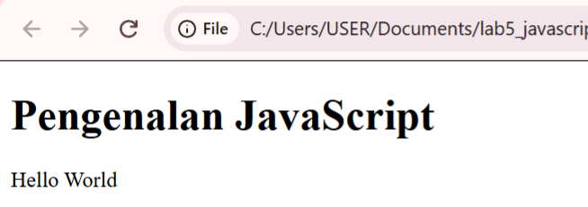
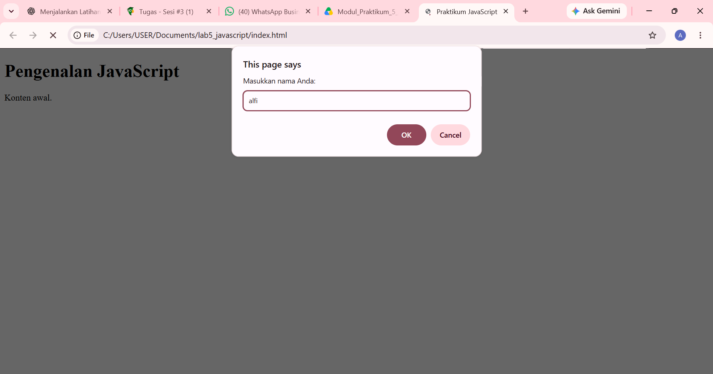
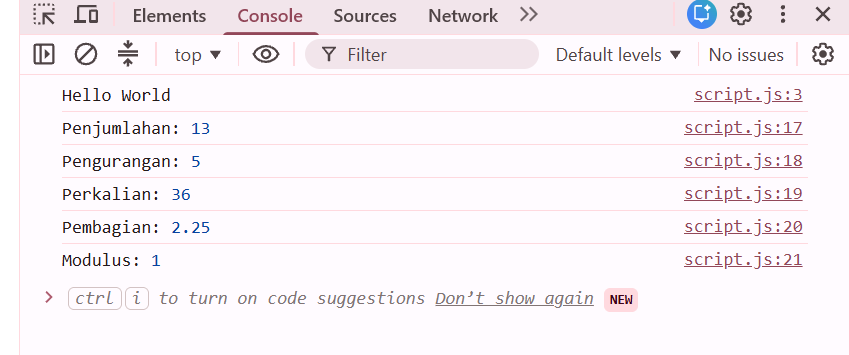
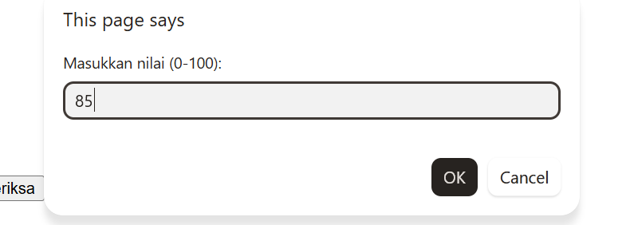
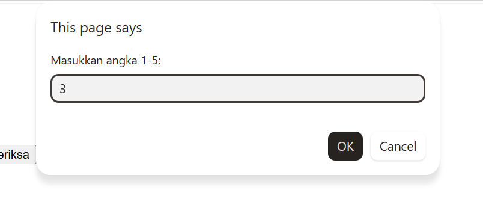
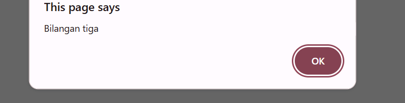
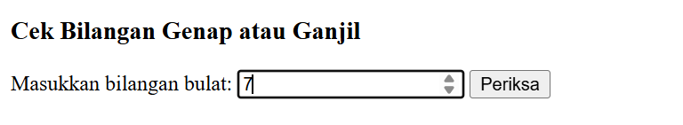

# Lab5Web Laporan Praktikum 5: JavaScript Dasar dan Manipulasi HTML
# Identitas Praktikum
- Mata Kuliah: Pemrograman Web
- Pertemuan: 5
- Topik: JavaScript dasar dan manipulasi elemen HTML
- Nama:Alfi Iftihal Nurul Afiat
- NIM: 312510041
- Kelas: I251D
# A. Tujuan Praktikum
1. Memahami sintaks dasar JavaScript dan cara menyisipkan JavaScript
   pada HTML.
2. Menggunakan variabel, tipe data, operator, percabangan, perulangan,
   dan function.
3. Menampilkan informasi melalui Console, alert, prompt, dan elemen
   HTML.
4. Memanipulasi konten serta gaya elemen HTML menggunakan JavaScript.
5. Membuat interaksi sederhana pada form dan melakukan validasi input.
6. Mendokumentasikan pekerjaan praktikum beserta hasil pengujiannya.
# B. Perangkat yang Digunakan
- Laptop atau PC
- Visual Studio Code
- Browser web, misalnya Google Chrome
- Berkas ````index.html```` dan ````script.js````
# C. Langkah Kerja
1. Membuat folder kerja bernama ````lab5_javascript````.
2. Membuat file ````index.html```` dan ````script.js```` di dalam folder tersebut.
3. Menghubungkan JavaScript ke HTML menggunakan tag
   ````<script src="script.js"></script>````.
4. Menjalankan ````index.html```` melalui browser.
5. Menguji setiap latihan dan memeriksa hasilnya di halaman web, kotak
   dialog, atau Console sesuai kebutuhan.
6. Menyimpan screenshot hasil pengujian untuk dokumentasi.
# D. Hasil Praktikum
## Latihan 1. Menampilkan Output
## Tujuan: Menampilkan teks pada halaman web dan Console.
Kode JavaScript:
````
document.getElementById("pesan").textContent = "Hello World";
console.log("Hello World");
````
Hasil: Teks ````Hello World```` tampil pada elemen HTML dengan id ````pesan````
dan juga muncul pada Console browser.

Perbedaan output: ````textContent```` menampilkan teks di halaman web,
sedangkan ````console.log()```` menampilkan pesan di Console untuk membantu
pemeriksaan program.

## Latihan 2. Alert dan Prompt
## Tujuan: Meminta nama pengguna dan menampilkan sapaan.
Hasil: Program meminta pengguna memasukkan nama melalui ````prompt()````.
Jika nama diisi, program menampilkan alert sapaan dan memperbarui teks
halaman menjadi "Selamat datang, \(nama\).". Jika nama kosong atau
pengguna membatalkan prompt, program menampilkan pesan "Nama belum
diisi."
````
const namaPengguna = prompt("Masukkan nama Anda:", "");

if (namaPengguna && namaPengguna.trim() !== "") {
  alert("Halo, " + namaPengguna + "!");
  document.getElementById("pesan").textContent = "Selamat datang, " + namaPengguna + ".";
} else {
  alert("Nama belum diisi.");
}
````


## Latihan 3. Function dan Operasi Aritmetika
## Tujuan: Menghitung penjumlahan, pengurangan, perkalian, pembagian,
dan sisa bagi dari dua bilangan.
Program menjalankan operasiDasar(9, 4).
````
function operasiDasar(a, b) {
  console.log("Penjumlahan:", a + b);
  console.log("Pengurangan:", a - b);
  console.log("Perkalian:", a * b);
  console.log("Pembagian:", b !== 0 ? a / b : "Tidak dapat dibagi nol");
  console.log("Modulus:", a % b);
}

operasiDasar(9, 4);
````
Hasil yang diharapkan di Console:
Penjumlahan: 13
Pengurangan: 5
Perkalian: 36
Pembagian: 2.25
Modulus: 1

## Latihan 4. Percabangan if-else
## Tujuan: Menentukan status kelulusan berdasarkan nilai yang
dimasukkan.
Aturan program: - Nilai 60 sampai 100: "Lulus". - Nilai di bawah 60:
"Belum lulus". - Input kosong, dibatalkan, bukan angka yang valid, atau
di luar rentang 0--100: "Input nilai tidak valid."
````
const inputNilai = prompt("Masukkan nilai (0–100):");
const nilaiMahasiswa = Number(inputNilai);

if (inputNilai === null || inputNilai.trim() === "" ||
    Number.isNaN(nilaiMahasiswa) || nilaiMahasiswa < 0 || nilaiMahasiswa > 100) {
  alert("Input nilai tidak valid.");
} else if (nilaiMahasiswa >= 60) {
  alert("Lulus");
} else {
  alert("Belum lulus");
}
````


## Latihan 5. Seleksi switch
## Tujuan: Menampilkan nama bilangan berdasarkan angka 1 sampai 5.
````
const inputPilihan = prompt("Masukkan angka 1–5:");

switch (inputPilihan) {
  case "1": alert("Bilangan satu"); break;
  case "2": alert("Bilangan dua"); break;
  case "3": alert("Bilangan tiga"); break;
  case "4": alert("Bilangan empat"); break;
  case "5": alert("Bilangan lima"); break;
  default: alert("Pilihan tidak tersedia");
}
````
Hasil yang diharapkan: - Input 1: "Bilangan satu". - Input 2:
"Bilangan dua". - Input 3: "Bilangan tiga". - Input 4: "Bilangan
empat". - Input 5: "Bilangan lima". - Input lain: "Pilihan tidak
tersedia".


## Latihan 6. Form Bilangan Genap atau Ganjil
## Tujuan: Memeriksa apakah bilangan bulat termasuk genap atau ganjil.

Hasil yang diharapkan: - Bilangan yang habis dibagi 2 menampilkan
"Bilangan genap". - Bilangan yang tidak habis dibagi 2 menampilkan
"Bilangan ganjil". - Input kosong atau bukan bilangan bulat menampilkan
pesan validasi.

Pengujian yang disarankan: Angka positif, angka negatif, nol,
bilangan desimal, dan input kosong.


Latihan 7. Mengubah Warna Halaman
Tujuan: Mengubah warna latar halaman menggunakan function dengan
parameter.

Hasil yang diharapkan: - Tombol "Latar Hijau" mengubah latar menjadi
hijau muda. - Tombol "Latar Putih" mengubah latar menjadi putih. -
Tombol "Latar Kuning" mengubah latar menjadi kuning muda.

Dokumentasi: Tambahkan screenshot salah satu perubahan warna.
Latihan 8. Checkbox Menu Makanan
Tujuan: Menghitung total harga menu yang dipilih melalui checkbox.

Daftar menu: - Ayam Goreng: Rp5.000 - Tempe: Rp500 - Telur Dadar:
Rp2.500

Hasil yang diharapkan: - Ayam Goreng dipilih: total Rp5.000. - Ayam
Goreng dan Tempe dipilih: total Rp5.500. - Semua menu tidak dipilih:
total Rp0.

Total diperbarui saat checkbox dicentang atau dilepas.

Dokumentasi: Tambahkan screenshot ketika satu atau lebih menu
dipilih dan total harga berubah.
Mini Project. Kalkulator Nilai Mahasiswa
Tujuan: Menghitung nilai akhir, menentukan predikat, dan menampilkan
status kelulusan.

Bobot penilaian: - Tugas: 30% - UTS: 30% - UAS: 40%

Rumus nilai akhir:

Nilai akhir = (nilai tugas × 0,30) + (nilai UTS × 0,30) + (nilai UAS × 0,40)

Aturan predikat: - Nilai ≥ 85: A - Nilai ≥ 75: B - Nilai ≥ 60: C -
Nilai ≥ 50: D - Nilai < 50: E

Nilai akhir minimal 60 dinyatakan lulus.

Contoh pengujian: - Tugas: 85 - UTS: 78 - UAS: 88 - Nilai akhir:
84,10 - Predikat: B - Status: Lulus

Dokumentasi: Tambahkan screenshot hasil kalkulator nilai dan
pengujian input tidak valid.
E. Jawaban Pertanyaan dan Tugas
1. Jelaskan perbedaan console.log(), alert(), prompt(), dan textContent/innerHTML.
- console.log() menampilkan informasi di Console browser. Umumnya
  digunakan untuk memeriksa nilai variabel dan hasil proses program.
- alert() menampilkan kotak dialog berisi pesan dan menunggu
  pengguna menekan tombol OK.
- prompt() menampilkan kotak dialog yang meminta pengguna memasukkan
  teks. Hasilnya berupa string atau null jika pengguna menekan
  Cancel.
- textContent membaca atau mengubah teks di dalam elemen HTML tanpa
  menafsirkan teks sebagai HTML.
- innerHTML membaca atau mengubah isi elemen sebagai markup HTML.
  Karena browser menafsirkan markup tersebut, penggunaannya perlu
  hati-hati jika kontennya berasal dari input pengguna.
2. Apa perbedaan let dan const? Berikan contoh.
let digunakan untuk variabel yang nilainya dapat ditetapkan ulang.
const digunakan untuk variabel yang tidak dapat ditetapkan ulang
setelah deklarasi.

Contoh:
let umur = 20;
umur = 21;

const nama = "Rani";
// nama = "Dina"; // Akan menghasilkan error karena nama dideklarasikan dengan const
3. Apa perbedaan operator == dan ===?
Operator == membandingkan nilai dengan memungkinkan konversi tipe
data. Operator === membandingkan nilai sekaligus tipe datanya tanpa
konversi tipe.

Contoh:
console.log(5 == "5");  // true
console.log(5 === "5"); // false
Dalam banyak kasus, === lebih disarankan agar perbandingan lebih jelas
dan menghindari konversi tipe yang tidak diinginkan.
4. Jelaskan fungsi if-else dan switch. Kapan masing-masing dapat digunakan?
if-else menjalankan blok kode berdasarkan kondisi benar atau salah.
Struktur ini cocok untuk rentang nilai atau kondisi logis, misalnya
menentukan lulus jika nilai minimal 60.

switch memilih tindakan berdasarkan kecocokan suatu ekspresi dengan
beberapa nilai tertentu. Struktur ini cocok untuk pilihan tetap,
misalnya mengubah input angka 1 sampai 5 menjadi nama bilangan.
5. Apa fungsi parameter dan return dalam function?
Parameter adalah variabel yang menerima nilai masukan ketika function
dipanggil. return mengirimkan hasil dari function kembali ke bagian
program yang memanggilnya.

Contoh:
function hitungLuas(panjang, lebar) {
    return panjang * lebar;
}

const luas = hitungLuas(8, 4);
console.log(luas); // 32
Pada contoh tersebut, panjang dan lebar merupakan parameter.
return mengembalikan hasil perkalian.
6. Bagaimana JavaScript memilih elemen HTML menggunakan document.getElementById()?
document.getElementById() memilih elemen HTML berdasarkan nilai
atribut id. Nilai id harus sesuai dengan elemen yang ada di HTML.

Contoh:
<p id="pesan">Konten awal</p>
document.getElementById("pesan").textContent = "Hello World";
Kode tersebut memilih elemen dengan id pesan, lalu mengubah teksnya
menjadi "Hello World". Jika elemen dengan id tersebut tidak ditemukan,
hasil pemilihannya adalah null.
7. Buat script untuk memvalidasi form agar nama tidak kosong dan nilai berada pada rentang 0--100.
Contoh berikut memvalidasi nama dan nilai yang dimasukkan:
<label for="nama">Nama:</label>
<input type="text" id="nama">

<label for="nilai">Nilai (0–100):</label>
<input type="number" id="nilai">

<button type="button" onclick="validasiForm()">Periksa</button>
<p id="hasilValidasi"></p>
function validasiForm() {
    const nama = document.getElementById("nama").value.trim();
    const inputNilai = document.getElementById("nilai").value;
    const nilai = Number(inputNilai);
    const hasil = document.getElementById("hasilValidasi");

    if (nama === "") {
        hasil.textContent = "Nama tidak boleh kosong.";
    } else if (
        inputNilai.trim() === "" ||
        !Number.isFinite(nilai) ||
        nilai < 0 ||
        nilai > 100
    ) {
        hasil.textContent = "Nilai harus berada pada rentang 0–100.";
    } else {
        hasil.textContent = "Data valid.";
    }
}
Validasi ini memastikan nama tidak kosong dan nilai berada dalam rentang
0 sampai 100.
F. Kesimpulan
Praktikum ini memperkenalkan dasar JavaScript untuk menampilkan output,
menerima input pengguna, melakukan operasi aritmetika, menggunakan
function dan percabangan, serta memanipulasi elemen HTML melalui DOM.
Praktikum juga menerapkan interaksi melalui tombol dan checkbox,
validasi input, serta perhitungan nilai akhir mahasiswa.
